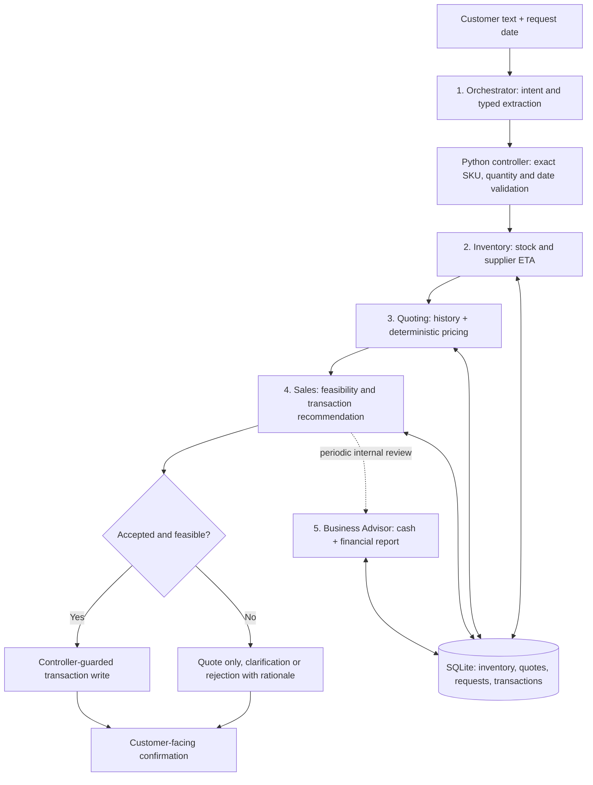
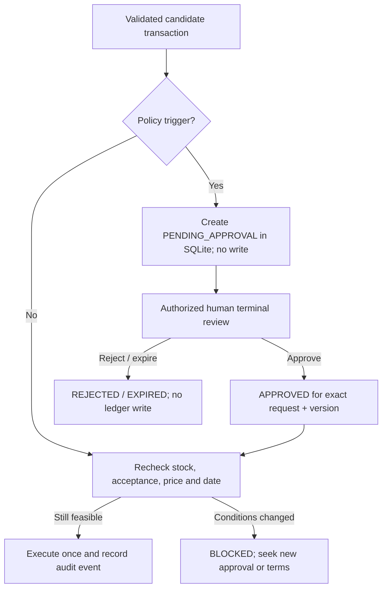

# Beaver's Choice Paper Company
## Final Design, Reflection, and Evaluation Plan

**Udacity Module 4 — Multi-Agent Systems**  
**Starter repository name:** Munder Difflin Paper Company  
**Implementation:** `project_starter.py` (consolidated Python source)  
**Framework and data layer:** PydanticAI · Python · SQLite/SQLAlchemy · pandas · NumPy  
**Model endpoint:** Udacity OpenAI-compatible proxy (`https://openai.vocareum.com/v1`)  
**Document revision:** October 29, 2026  
**Related files:** `Design_Notes.txt`, `Munder_Difflin_Workflow.png`, `quote_requests_sample.csv`, and (once generated) `test_results.csv`

> **Evidence and implementation status.** This document is a final *design and reflection artifact*, not a claim that all rubric tests have passed. The current code was inspected and passed Python syntax checks plus an **isolated, stubbed-agent SQLite smoke test**. The authentic full-sample, live-Udacity-model run was **not available for verification** in the reviewed files. Any outcome reported as a local smoke-test result is labeled accordingly. Human-in-the-Loop (HITL) approval queues and the proposed modular package are **future improvements, not currently deployed features**.

---

## 1. Project Overview and Objectives

Beaver's Choice Paper Company (called *Munder Difflin Paper Company* in the supplied starter repository) needs a text-based operational assistant for customer requests, inventory management, intelligent quotations, and eligible order fulfillment. The assignment restricts the solution to **no more than five agents** and requires that each prescribed starter helper participate in the system's tooling.

The solution targets five business outcomes:

1. Interpret informal requests into structured product, quantity, intent, request-date, and deadline data.
2. Check actual catalog-backed stock and supplier lead times before making commitments.
3. Create explainable, competitive quotes based on price rules and prior quote context.
4. Record a sale **only after** customer acceptance and feasibility checks; give clear reasons when an order cannot be fulfilled.
5. Make internal inventory and cash reporting available for advisory decisions without exposing business-sensitive numbers to customers.

The principal architectural choice is to separate **LLM interpretation** from **deterministic financial authority**. A language model may recognize customer intent and consult database tools; it must not invent inventory, override a numerical pricing policy, or directly authorize a ledger write.

## 2. Architecture and Agent Responsibilities

The implemented team contains **exactly five PydanticAI agents**. Business-rule functions and future human approval services are components, **not additional agents**.

| Agent | Responsibility | Registered tools / methods | Key boundary |
|---|---|---|---|
| **1. Orchestrator** | Extract intent (`inventory`, `quote`, `order`, `report`, `unknown`), product descriptions, positive quantities, and explicit requested deadline | Typed `RoutedRequest` output; `process_request()` coordinates subsequent work | Cannot independently post sales or change inventory |
| **2. Inventory** | Retrieve stock snapshots, check an item's current stock, estimate supplier arrival for shortages | `snapshot_inventory`, `inspect_inventory`, `supplier_delivery` | Supplier arrival is not necessarily customer delivery |
| **3. Quoting** | Consult historical offers and describe controlled volume prices | `historical_quotes`, `calculate_customer_quote` | Historical examples inform, but do not replace, verified catalog pricing |
| **4. Sales Fulfillment** | Analyze feasibility and expose a guarded ledger tool for controller-authorized transactions | `check_order_feasibility`, `record_transaction` | A model response by itself cannot authorize a database write |
| **5. Business Advisor** | Examine private cash/financial snapshots, recommend operational adjustments | `read_cash_balance`, `financial_overview` | Internal financial data must remain separate from customer responses |

Nine tools are registered inside `build_agents()`: three Inventory, two Quoting, two Sales, and two Advisor tools. The Orchestrator uses a structured response schema rather than its own business-data tool. The controller (`process_request`, `build_line`, `execute_order`) supplies a programmatic handoff between them.

### 2.1 High-level data flow




The diagram describes the **current automated decision path**. Section 7 adds a proposed HITL checkpoint between feasibility validation and transaction commitment. It is not yet active in the Python script.

### 2.2 Step-by-step request processing

1. **Input and parsing.** The Orchestrator receives text plus `request_date`; its Pydantic schema structures intent, items, and any explicit delivery deadline. A quote question is not classified as a confirmed purchase without clear acceptance.
2. **Catalog validation.** `resolve_item()` maps descriptions to known item names. Unknown or insufficiently specific requests return clarification instead of creating a fictitious SKU. Duplicate entries referring to one SKU are aggregated for stock calculations.
3. **Inventory inspection.** The controller uses `get_stock_level()`; the Inventory Agent has tools for a full stock snapshot and supplier estimates. When stock is short, `get_supplier_delivery_date()` estimates incoming supply timing.
4. **Quote computation.** The Quoting Agent has historical lookup tools. `price_line()` determines numerical unit and extended prices with `Decimal`, avoiding free-form LLM arithmetic.
5. **Fulfillment decision.** `execute_order()` checks customer acceptance, impossible dates, shortages, and available stock again before calling a controller-guarded ledger function. An inquiry can remain `quoted`; rejected or unfulfilled orders include an explanation.
6. **Customer communication and internal pulse.** The controller formats text containing quantities, item descriptions, quoted price and reason. Every fifth evaluated scenario can trigger Business Advisor analysis. Advisory cash and reporting information should stay internal.

## 3. Starter Helper Functions and Data Design

The integrated script preserves the **seven helper-function interfaces required by the rubric**, while incorporating them into a larger application. It also includes stock seeding, CSV loading, SQLite initialization, and reporting logic. This should be understood as a consolidated educational implementation rather than proof that every original starter line remains unchanged.

| Required helper | Used by | Contribution |
|---|---|---|
| `create_transaction(item_name, transaction_type, quantity, price, date)` | Sales `record_transaction` tool; controller-authorized purchases | Records a `sales` or `stock_orders` ledger entry |
| `get_all_inventory(as_of_date)` | Inventory `snapshot_inventory` tool | Stock counts by SKU as of the specified date |
| `get_stock_level(item_name, as_of_date)` | Inventory `inspect_inventory`; Sales feasibility/controller | One product's date-sensitive on-hand quantity |
| `get_supplier_delivery_date(input_date_str, quantity)` | Inventory `supplier_delivery`; Sales feasibility and reorder calculation | Estimated **supplier** arrival date by quantity |
| `get_cash_balance(as_of_date)` | Advisor `read_cash_balance`; replenishment affordability check | Sales revenues minus stock purchases as of a date |
| `generate_financial_report(as_of_date)` | Advisor `financial_overview` | Cash, inventory value, total assets and leading sellers |
| `search_quote_history(search_terms, limit=5)` | Quoting `historical_quotes`; deterministic pricing history check | Similar historical requests and quote explanations |

**Additional source functions:** `generate_sample_inventory()` selects a reproducible seeded inventory sample; `init_database(db_engine, seed=137)` loads `quote_requests.csv` and `quotes.csv`, creates inventory and transactions tables, and resets the project database; `sql_df()` is a SQLAlchemy-backed DataFrame query adapter.

**Important operating constraint:** `init_database()` replaces demonstration tables. Every application run via the current `__main__` entry point resets the local project database. This is appropriate only for disposable coursework evaluation data, not a persistent enterprise order-management database.

The SQLite transaction ledger is the financial and stock source of truth: incoming stock orders add quantity, and recorded sales reduce quantity. Financial state is derived from transaction records. For future deployments, transaction dates and purchasing cash flows should be modeled with more precision.

## 4. Pricing, Fulfillment, and Customer Communication

### 4.1 Controlled quote policy

`price_line()` bases a quotation on the catalog `unit_price` and illustrative configuration values in the consolidated source:

| Quantity / condition | Current calculation rule |
|---|---|
| Base quotation | 25% markup over catalog unit price |
| 100–499 units | 5% bulk discount |
| 500–999 units | 10% bulk discount |
| 1,000+ units | 15% bulk discount |
| 500+ units, at least three comparable history matches | Additional 1 percentage-point adjustment |
| All prices | At least 5% above catalog cost basis, with customer unit price rounded to cents |

These are **educational policy assumptions** and must not be represented as verified client-approved margins or negotiated supplier terms. The quoted unit price is calculated and then multiplied by quantity, producing a reproducible customer-facing total. If the price floor overrides a nominal volume discount, a later enhancement should calculate and display the **effective** discount accurately.

### 4.2 Fulfillment decisions

- **Inventory answer:** provide currently available quantity and explain stock readiness; do not create a sale.
- **Quote without purchase acceptance:** return priced terms and status `quoted`; do not post a sale.
- **Accepted and feasible purchase:** revalidate stock, quantity, and any deadline; then record sale entries and report `fulfilled`.
- **Insufficient current stock:** return `unfulfilled`, showing available versus requested quantity and estimated supplier arrival without falsely promising shipment.
- **Impossible delivery deadline:** return `rejected`, identifying the timing conflict.
- **Unknown or unsupported SKU:** return `clarification`; do not substitute an unverified item.

The `--simulate-acceptance` flag intentionally treats quote requests as accepted **only for coursework evaluation**. It is not evidence of real customer approval or a safe default for production use. The optional `--auto-reorder` flag creates stock orders without an interactive managerial approval mechanism; it should likewise remain off outside controlled tests.

### 4.3 Customer transparency and privacy

Customer-facing output should contain the product name, quantity, unit quote, total, relevant volume pricing explanation, requested deadline where provided, and a specific fulfillment or rejection rationale. It should **not** expose internal cash balances, supplier cost basis, precise margins, private historic quote content, API keys, raw SQL errors, or nonessential personally identifiable information.

## 5. Evaluation Strategy and Observed Results

### 5.1 Requirement-driven test design

Tests should cover a diverse request matrix rather than only happy-path sales:

| Dimension | Positive test | Negative or boundary test |
|---|---|---|
| Routing | Clear paper order with quantity/date | Ambiguous customer intent or missing quantity |
| Catalog | Exact stock-keeping item | Unsupported item, size or specification |
| Inventory | Quantity within on-hand stock | Request greater than available stock |
| Timing | Deliverable before stated deadline | Supplier ETA beyond deadline or past deadline |
| Quoting | Historical precedent and bulk tier | Missing precedents, floor override or unusual quantity |
| Sales | Accepted order changes inventory/cash | Quote-only does not change the ledger |
| Security | Finance agent receives private report | Customer response contains no internal financial data |
| Idempotency (future) | One authorized order → one sale | Repeat identical request must not post twice |
| HITL (future) | Approved flagged order proceeds after revalidation | Missing, expired or rejected approval blocks all writes |

### 5.2 Verified *isolated* local tests

The consolidated `project_starter.py` has **781 physical lines**, **24 top-level functions**, three defined typed structures (`RequestedItem`, `RoutedRequest`, `PlannedLine`), and five instantiated agents in `build_agents()`. These are code-inspection measurements, not runtime quality scores.

The script passed `python -m py_compile`. A local test harness used a disposable SQLite database, small synthetic historical CSV fixtures and a **stubbed Orchestrator response** to exercise the real deterministic business logic. Results observed:

| Isolated test result | Outcome |
|---|---:|
| Synthetic order scenarios executed | 4 |
| Orders fulfilled | **3** |
| Orders rejected with clear reason | **1** |
| Requests with a positive cash-balance change | **3** |
| Individual cash movements | **+$12.60, +$10.00, +$1.20** |
| Rejection condition | Supplier arrival misses requested deadline |
| Syntax validation | **Passed** |
| Additional helper checks | Stock queries, financial report, historical quote search, catalog aliases |

The rejection case requested 100,000 units of an item by April 2, 2025, while the test's estimated supplier arrival was April 8, 2025. The system correctly rejected the infeasible deadline instead of booking an impossible order. These are controlled test facts and do **not** demonstrate live LLM routing performance.

### 5.3 Full-course evaluation: **not yet independently verified**

The actual Udacity `quote_requests_sample.csv` and generated `test_results.csv` from a live proxy run were **not available among the reviewed local artifacts**. Accordingly, the actual full-dataset fulfillment count, failure distribution, model reliability, and rubric pass status remain **unverified**.

| Grading target | Rubric threshold | Official full-sample evidence |
|---|---|---|
| Fulfilled customer requests | At least 3 | **Pending live run** |
| Requests causing cash movement | At least 3 | **Pending live run** |
| Rejected/unfulfilled requests with reason | At least 1 | **Pending live run** |
| Every row in the sample represented | All rows | **Pending CSV inspection** |
| Customer-facing explanations and privacy | Clear, relevant, non-sensitive | **Pending qualitative review** |

> **Do not substitute the four-case smoke test for the full-course `test_results.csv`.** A submission should contain the authentic file produced by the official sample runner, not fabricated or hand-entered outcomes.

### 5.4 Reproducing the official test in the Udacity workspace

Use **Python 3.10 or later** (3.11 recommended): the integrated file uses modern union type annotations such as `str | None`, even though the original course README mentions Python 3.8+. Place `project_starter.py`, `quotes.csv`, `quote_requests.csv` and `quote_requests_sample.csv` in one working directory. Install from the workspace's requirements, plus the chosen PydanticAI dependency:

```bash
python -m pip install -r requirements.txt
python -m pip install 'pydantic-ai-slim[openai]' python-dotenv
```

Create a **local, untracked** `.env` file with `UDACITY_OPENAI_API_KEY`, optionally `UDACITY_OPENAI_BASE_URL` and a `UDACITY_MODEL` supported by the Udacity proxy. Never publish the key or commit `.env`.

For a **disposable, seeded course test database only**, run:

```bash
python project_starter.py --csv quote_requests_sample.csv --simulate-acceptance
```

This command resets the project database, simulates quote acceptance for evaluation, reads every sample row, and is designed to generate `test_results.csv`. Do not use it for real customer orders. Use `--auto-reorder` only when intentionally testing replenishment; it has no human authorization queue.

After the run, confirm (a) sample row count matches result row count; (b) the output has at least three `fulfilled` statuses; (c) at least three rows have nonzero `cash_change`; and (d) at least one row has a `rejected`, `unfulfilled`, or `clarification` status with an understandable customer reason. Inspect quoted totals, cash values, SKU selection, supplier dates and protected data for plausibility. Attach the genuine CSV, and replace the “Pending” cells above with the observed numbers.

### 5.5 Interpretation of the current evidence

The isolated test shows that the **deterministic path** can fulfill multiple valid sales, change cash correctly, and reject a deadline conflict. It supports the choice to keep financial posting out of free-form model text. It does *not* yet establish extraction accuracy over the diverse official requests, tool invocation reliability through a live proxy, realistic delivery estimates, or a final Udacity rubric pass.

## 6. Findings, Strengths, and Limitations

**Strengths demonstrated in the reviewed code**

- Clear division between five agent roles, with a single controller coordinating the sequence.
- Pydantic models constrain structured routing and positive item quantities.
- Seven required helper functions are accessible through tools and guarded processes.
- Exact catalog identifiers, repeat-SKU aggregation, stock checks and date comparisons reduce preventable transaction failures.
- Pricing uses repeatable Decimal calculations; quote-only inquiries ordinarily have no ledger effect.
- Customer-facing text includes actionable rejection reasons rather than exposing stack traces.
- Optional finance reporting is intentionally separate from customer responses.

**Important limitations and caveats**

- **No fully implemented Human-in-the-Loop queue:** neither a persistent pending-approval record nor authenticated reviewer actions exist today.
- **Multi-line transactions are not atomic:** each approved line is inserted independently. If a later line fails, an earlier line could remain recorded.
- **No durable idempotency:** rerunning an accepted request can post a duplicate sale unless the external test environment is reset.
- **SKU attributes are incomplete:** a phrase such as “A4 glossy paper” may map to generic “Glossy paper”; this does not prove the size specification is available.
- **Delivery modeling is limited:** supplier arrival is not dispatch or customer delivery; transport time and business-day constraints are not modeled.
- **Historical comparison is approximate:** keyword matching is not equivalent to a normalized, quantity-adjusted comparable quote set.
- **Optional worker narration can fail separately:** model response text is not authoritative; the core controller's deterministic checks remain the intended authority.
- **Database initialization resets project state:** the current CLI is for repeatable simulations rather than long-lived business operations.

## 7. Human-in-the-Loop (HITL) Assessment and Recommendation

### 7.1 What is implemented versus proposed

| Control | Current implementation | Interpretation |
|---|---|---|
| Customer acceptance before sale | `execute_order(..., accepted=...)` | Partial human/customer confirmation gate, which simulation can bypass |
| Controller-only write authorization | `_WRITE_ALLOWED` ContextVar and guarded `record_transaction()` | Deterministic application safeguard; **not human approval** |
| Finance-aware reorder flag | `cash_safe_restock()` behind `--auto-reorder` | Automated affordability check; **not a purchasing approval** |
| Human approve/reject queue | **Not implemented** | Needs persistent state and reviewer interface |
| Escalation for pricing and fulfillment exceptions | **Not implemented** | Needs explicit workflow and policy rules |
| Auditable human decision and identity | **Not implemented** | Needs review roles, decision reasons, timestamps, and audit log |

### 7.2 Recommended intervention points

The following are **example policy thresholds only**, not claimed corporate requirements:

| Intervention | Illustrative trigger | Human decision authority | Automated behavior while pending |
|---|---|---|---|
| Exceptional quote | Discretionary discount greater than **15%** or nonstandard pricing | Sales Manager | Preserve quote as pending; **do not** book sale |
| High-value sale | Proposed order greater than **$5,000** | Sales/Finance reviewer | Hold final booking until authorized |
| Supplier replenishment | Proposed purchase greater than **$2,000** | Purchasing/Finance Manager | Create recommendation, **not** a stock-order ledger entry |
| Fulfillment exception | Partial fill, item substitution or deadline miss | Customer **and** Operations | Do not silently change requested terms |
| Financial anomaly | Duplicated request, suspicious amount, reconciliation mismatch | Finance reviewer | Block affected ledger mutation and escalate |

The normal tiered discount already in the current code does not automatically imply a manager-approved discretionary discount. Triggering should be based on the *actual* applied policy and the customer's final terms.

### 7.3 Proposed approval-state machine



A proposed `approval_requests` table would track a request/order identifier, immutable version, action type, threshold/risk reason, sanitized request payload, current state, requesting timestamp, expiry, reviewer role/identity, decision timestamp, and decision reason. An append-only `approval_events` table would provide a chronological audit trail. Neither table currently exists in the submitted implementation.

A minimal **text-based terminal interface** could list pending approvals, accept an approval ID, require an authorized reviewer decision, and record a reason. This meets the project's text-only interaction pattern and does **not** introduce an additional agent.

### 7.4 Approval enforcement requirements

1. **Fail closed:** missing, denied, expired, or wrong-request approval prevents execution.
2. **Separate duties:** the requesting agent or unverified model output cannot approve its own transaction.
3. **No premature ledger effect:** pending reviews cannot recognize revenue, decrement stock or register inventory purchases.
4. **Revalidate after approval:** current stock, accepted price, deadline, customer consent and cash must still satisfy policy.
5. **Version and replay protection:** an approval applies only to one immutable request/version and one idempotent execution.
6. **Minimum necessary disclosure:** show reviewer details privately; give customers only a relevant “pending review,” “approved,” or “cannot fulfill” message.
7. **Measure intervention cost:** track queue dwell time, overrides, blocked invalid actions and impact on customer responsiveness.

**Design justification:** risk-based human review balances business accountability against the need for quick low-risk transactions. The HITL service is a deterministic governance layer invoked by the controller, so the solution remains within the five-agent restriction.

## 8. Modularization Review and Maintainability Plan

### 8.1 Findings from the consolidated source

The reviewed `project_starter.py` consists of **781 physical lines and 24 top-level functions**, with five model-backed agents registered within `build_agents()`. That function also defines the nine tools. The code is functional as a consolidated educational script, but it mixes business layers and creates maintenance risk:

| Existing responsibility | Representative current code | Why separate it? |
|---|---|---|
| Configuration and model initialization | Environment variables, `build_agents()` | Switch model/credentials and policy without modifying business operations |
| Data persistence | `sql_df`, `init_database`, `create_transaction`, report helpers | Add testable transactions, migrations and session management |
| Product catalog | `paper_supplies`, `resolve_item`, `on_hand` | Improve exact SKU and size/finish validation |
| Pricing | `discount_for`, `price_line` | Test discounts, floor rules and history influence independently |
| Model schemas | `RequestedItem`, `RoutedRequest`, `PlannedLine` | Validate typed messages consistently across layers |
| Fulfillment | `build_line`, `execute_order`, `cash_safe_restock` | Introduce atomicity, idempotency, approval gates and reservations |
| Orchestration | `process_request`, `one_agent_response` | Keep agent handoffs distinct from transaction execution |
| Evaluation / CLI | `run_test_scenarios`, argument parser, `__main__` | Preserve realistic regression and grading tests |

### 8.2 Recommended modular project structure — **future development version**

```text
Agentic_AI_M4_Beavers-Choice/
├── project_starter.py                  # One-file Udacity grading artifact
├── munder_difflin/                    # Future maintainable development package
│   ├── __init__.py
│   ├── config.py                       # Environment, policy and model settings
│   ├── models.py                       # Typed Pydantic inputs/results
│   ├── database.py                     # SQLite repositories; starter helpers
│   ├── catalog.py                      # SKU normalization and validation
│   ├── pricing.py                      # Decimal quote engine and history policy
│   ├── agents.py                       # Exactly five PydanticAI agents/tools
│   ├── fulfillment.py                  # Sales, stock movements and transactions
│   ├── workflow.py                     # Orchestration and customer response
│   ├── approvals.py                    # FUTURE HITL policy, queue and audit
│   └── evaluation.py                   # Scenario tests and CSV output
├── tests/
│   ├── test_catalog.py
│   ├── test_pricing.py
│   ├── test_inventory.py
│   ├── test_fulfillment.py
│   └── test_approvals.py               # When HITL is implemented
├── quotes.csv
├── quote_requests.csv
└── quote_requests_sample.csv
```

**Submission constraint:** The rubric calls for **one Python file**. The multi-file organization is a recommendation for engineering maintenance, not the state of the current submission. The safest course deliverable remains the tested, consolidated `project_starter.py` with the workflow image, documentation and authentic evaluation CSV. After grading, preserve the interfaces through a package refactor and regression testing.

### 8.3 Recommended refactoring sequence

1. **Freeze a baseline.** Record current helper signatures, seed behavior and expected quote/order results. Store test fixtures and verify the consolidated file passes syntax and deterministic tests.
2. **Extract pure domain logic.** Move configuration, catalog resolution, Pydantic models, `Decimal` pricing, and date handling into importable modules with no database writes.
3. **Isolate data access.** Wrap SQLite connection/session lifecycle in a repository boundary; preserve the seven rubric helper APIs as adapters where needed.
4. **Extract agent registration and orchestration.** Centralize PydanticAI construction and tool injection; avoid circular imports and implicit global state.
5. **Isolate fulfillment and introduce atomicity.** A single database transaction should commit all order lines or roll them all back; use unique request IDs and inventory reservations.
6. **Introduce a deterministic HITL service.** Implement an approval policy and durable pending queue; attach approval state to exact order versions, revalidate on approval, and log every decision.
7. **Run regression/evaluation tests.** Compare quote totals, statuses, cash changes, inventory balances and customer explanation strings with the original baseline. Keep a generated single-file distribution if the one-file rule still applies.

### 8.4 Modularity and HITL together

`approvals.py` should **not** make financial decisions directly. It would classify a *proposed* action against a configurable policy, persist a `PENDING_APPROVAL` record, validate the reviewer's decision, and return an authorization token scoped to one request/version. `fulfillment.py` would remain responsible for revalidation and the final atomic write. This avoids scattering human-review conditions through the Inventory, Quoting and Sales agents while preserving the five-agent count.

## 9. Prioritized Improvement Roadmap

| Priority | Improvement | Rationale / proposed acceptance criteria | Status |
|---|---|---|---|
| **P0** | Complete authentic sample evaluation | Every CSV row processed, genuine `test_results.csv`, rubric counts met and reasons inspected | **Pending external run** |
| **P1** | Add risk-based HITL approvals | Pending actions cause zero ledger writes; only approved/version-matched actions execute | **Proposed** |
| **P1** | Atomic, idempotent multi-item sales | A failure rolls back all lines; duplicate request IDs cannot double-bill | **Proposed** |
| **P1** | Strengthen catalog and delivery semantics | Explicit SKU attributes and customer-delivery lead time; unclear matches fail safely | **Proposed** |
| **P2** | Modularize responsibilities | Unit-test catalog/pricing/data/fulfillment separately; same outputs as baseline | **Proposed** |
| **P2** | Govern pricing and replenishment | Approved price tables, true effective discounts, purchasing commitment vs receipt | **Proposed** |
| **P2** | Add observability and governance metrics | Trace IDs, decision reasons, retry metrics, review turnaround, audit completeness | **Proposed** |

**At least two distinct project improvements are satisfied** by the HITL governance recommendation and transaction atomicity recommendation; catalog fidelity, modularization and observability add a longer-term engineering roadmap.

## 10. Reflection and Lessons Learned

The project demonstrates why an agent team should not be treated as five unrestricted chatbots. Specialization gives useful delegation, but reliable business automation depends more heavily on data integrity, explicit state transitions, controlled tools, and deterministic approval boundaries. PydanticAI's typed routing limits ambiguous handoffs; validated Python functions remain the proper authority for quantities and financial movements.

The positive local results are meaningful: they show that seeded stock, exact products and simple quotes can lead to recorded transactions with observable cash impact. The rejection case is equally important because an agentic sales system must decline infeasible orders rather than making false delivery commitments. However, a limited test harness with stubbed agent responses cannot establish overall model quality. The full request dataset, real proxy access, and human inspection of customer explanations are indispensable for the rubric and any stronger reliability claim.

Two architectural discoveries will shape subsequent work. First, **human oversight must be implemented in stateful workflow logic**—a prompt asking an agent to “seek approval” is not an enforceable approval gate. Second, **maintainability is an architectural choice**: the nearly 800-line single-file format is acceptable for course submission, but explicit service boundaries are the right direction for real operations. The future development version should enforce stable domain interfaces, dependency injection, atomic ledger operations, and auditable HITL approvals while preserving the maximum five-agent structure.

## 11. Final Deliverables and Rubric Crosswalk

| Rubric requirement | Implementation/documentation evidence | Verification status |
|---|---|---|
| Maximum five distinct agents | Five PydanticAI agents in `build_agents()` and workflow diagram | **Source reviewed** |
| Clear responsibilities and dataflow | Sections 2–3 and `Munder_Difflin_Workflow.png` | **Documented** |
| Tool-to-starter-function mapping | Section 3 and nine registered tools | **Source reviewed** |
| Inventory, history-based pricing and sales | Sections 3–4; integrated Python implementation | **Local functional smoke test** |
| Readable, modularly organized logic | Named functions and typed structures; Section 8 refactoring plan | **Source reviewed; multi-file refactor proposed** |
| Three fulfilled requests and cash changes | Section 5.2: met in isolated synthetic test | **Full sample pending** |
| One unfulfilled/rejected request with explanation | Section 5.2: one timing rejection in synthetic test | **Full sample pending** |
| Full `quote_requests_sample.csv` coverage | `run_test_scenarios()` designed for every row | **Official run pending** |
| Detailed evaluation and two improvements | Sections 5–10 | **Documented** |
| HITL intervention points and governance | Section 7 with explicit implemented/proposed boundary | **Design only; not yet enforced** |

### Submission checklist

- [x] Consolidated Python source (`project_starter.py`) and source-code review.
- [x] Five-agent architecture illustration (`Munder_Difflin_Workflow.png`).
- [x] Updated design notes (`Design_Notes.txt`).
- [x] Integrated design, reflection and evaluation document (this Markdown file).
- [x] Local smoke tests, syntax verification, and clearly identified limitations.
- [ ] Run **every** official request with the live Udacity model and save genuine `test_results.csv`.
- [ ] Replace pending full-sample metrics in Section 5.3 with observed results before grading.
- [ ] Review sample-level customer communication and confirm rubric thresholds.
- [ ] Confirm Git excludes `.env`, credentials, local SQLite state and temporary test artifacts.

> **Credential handling:** If a real API key was ever committed to a public GitHub repository, rotate or revoke it. Removing `.env` and adding `.gitignore` prevents subsequent exposure, but does not remove secrets from existing Git history.

---

**Final assessment:** The five-agent solution has a coherent design with source-backed helper/tool mappings and passed isolated deterministic tests. The principal outstanding assessment is a complete, authentic dataset run through the supported Udacity model. HITL oversight, atomic transactions, normalized catalog attributes and modularization are concrete, prioritized enhancements—presented transparently as recommendations rather than already implemented functionality.
